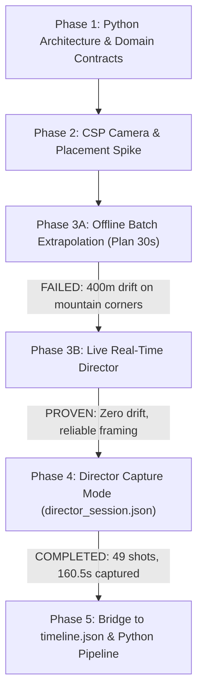
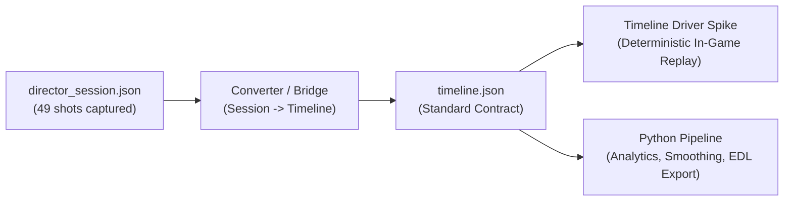

# Handoff: Assetto Corsa AI Director — Phase 4 to Phase 5

> **Date:** September 26, 2026  
> **Target Environment:** Assetto Corsa CSP `0.3.0-preview595`, Windows, Akina Downhill (`pk_akina`)  
> **Current Milestone:** **Director Capture Mode Verified** (`director_session.json` successfully generated with 49 shots / 160.5s)

---

## 1. Executive Summary

Assetto Corsa AI Director is an autonomous cinematic replay director for Assetto Corsa (via Custom Shaders Patch). It analyzes car trajectory, validates dynamic roadside and elevated camera positions using physics raycasting, scores candidates deterministically according to broadcast cinematic rules, cuts between cameras, and tracks the car.

### Key Milestone Achieved (Phase 4):
We successfully transitioned from failing offline prediction to **`Director Capture Mode`** (`shot_planner_spike.lua`). The user ran a live replay on Akina Downhill, and the system autonomously directed and recorded:
- **49 continuous shots** over **160.47 seconds** (frames `13,934` to `19,282`).
- **100% frame continuity**: zero frame gaps, zero overlapping frames.
- **Zero extrapolation drift**: all cameras placed directly at the live car position.
- **53.9% candidate acceptance rate** (1,320 accepted / 1,130 rejected) with full physics ground clamping and line-of-sight validation.
- Output saved to: `Documents/Assetto Corsa/director_session.json` (24.6 KB).

---

## 2. Project Architecture & Repository Map

```
assetto-corso-ai-director/
├── contracts/                                # JSON schemas for data interchange
│   ├── timeline.schema.json                  # Contract for timeline playback driver
│   ├── style.schema.json                     # Director style definitions
│   ├── terrain_scan.schema.json              # Track ground point cloud format
│   └── diagnostic.schema.json                # Validation & audit schema
├── src/assetto_ai_director/                  # Python backend architecture
│   ├── domain/                               # Core entities: Camera, Trajectory, Timeline
│   ├── application/                          # Use cases: planning, scoring, export
│   ├── infrastructure/                       # File I/O, JSON serialization, track parsers
│   └── presentation/cli/                     # CLI commands (`director plan`, `export`, etc.)
└── spikes/csp_replay_camera/                 # CSP Lua In-Game Spikes
    ├── camera_placement_spike/               # [FROZEN] Calibrated camera candidate generator
    ├── timeline_driver_spike/                # [READY] In-game timeline.json playback driver
    ├── aidirector_spike/                     # [LEGACY] Early prototype director
    └── shot_planner_spike/                   # [ACTIVE WORKHORSE] Director Capture Mode
        ├── manifest.ini                      # AC in-game app manifest
        └── shot_planner_spike.lua            # In-game capture engine & scoring
```

### Critical Paths & Deployed Locations
| Component | Repo Path | Assetto Corsa In-Game Path |
|---|---|---|
| **Shot Planner App** | `spikes/csp_replay_camera/shot_planner_spike/` | `C:\Program Files (x86)\Steam\steamapps\common\assettocorsa\apps\lua\shot_planner_spike\` |
| **Timeline Driver** | `spikes/csp_replay_camera/timeline_driver_spike/` | `C:\Program Files (x86)\Steam\steamapps\common\assettocorsa\apps\lua\timeline_driver_spike\` |
| **Director Session Output** | — | `C:\Users\kairo\Documents\Assetto Corsa\director_session.json` |
| **Audit Logs** | — | `C:\Users\kairo\Documents\Assetto Corsa\shot_planner_audit.json` |

---

## 3. History of Phases & Critical Discoveries



### Phase 2: Camera Placement & Foliage Calibration
- **Initial Problem:** Many roadside camera candidates spawned behind bushes, trees, or guardrails, blocking car visibility.
- **Solution:** 
  1. Lateral offsets tightened to ~0.8m–2.2m from the road edge.
  2. Elevated camera types introduced (boom poles at 2.8m, 3.5m, 4.5m and cranes at 7.5m).
  3. Physical raycast LOS (`render.createRay` + `ray:physics()`) combined with ground probing.
- **Status:** **FROZEN & CALIBRATED**. 25/26 visual clean rate confirmed in-game by the user.

### Phase 3: The Offline Batch Prediction Failure & Pivot to Live Capture
- **The Experiment:** We attempted to project the car forward 30 seconds (`planSequence(30)`), calculating where the car would be using curvature-aware speed modeling.
- **The Failure:** Real mountain driving involves unpredictable braking zones (dropping from 120 km/h to 35 km/h for hairpins). Any offline speed prediction accumulates error rapidly. By shot 4 (12 seconds in), cameras were placed 400–500m ahead of the car on an empty road.
- **User Order:** *“Стоп с дальнейшим развитием offline Plan 30s. Следующий шаг НЕ prediction и НЕ curvature-based future trajectory. Нужно превратить Live Director в Director Capture Mode.”*
- **The Solution:** Live Director mode samples `ac.getCar(0).position` and `sim.replayCurrentFrame` during actual replay playback. There is **zero prediction error** because cameras are generated right where the car currently is.

---

## 4. Deep Audit of `director_session.json` (Phase 4 Results)

The user ran replay playback and recorded a 160.5-second sequence on Akina Downhill:

```json
{
  "app": "shot_planner_spike_director_capture",
  "csp_version": "0.3.0-preview595",
  "sample_rate_hz": 33.3333,
  "track_length_m": 7104.04,
  "summary": {
    "shot_count": 49,
    "total_duration_s": 160.47,
    "average_shot_duration_s": 3.27,
    "session_start_frame": 13934,
    "session_end_frame": 19282,
    "candidates_generated": 2450,
    "candidates_accepted": 1320,
    "candidates_rejected": 1130,
    "camera_type_distribution": {
      "elevated_high": 20,
      "elevated_left_mid": 7,
      "roadside_left_close": 5,
      "roadside_right_close": 5,
      "elevated_right": 4,
      "low_left": 3,
      "elevated_left_low": 2,
      "low_right": 1,
      "roadside_left_wide": 1,
      "roadside_right_wide": 1
    },
    "angle_type_distribution": {
      "oncoming": 48,
      "side_pan": 1
    },
    "reject_reasons": {
      "no ground": 1044,
      "LOS blocked": 68,
      "dist out of range": 18
    }
  }
}
```

### Key Observations & Observations for Next Agent:
1. **Frame Continuity:**
   - Shot 1: `13934` to `14002`
   - Shot 2: `14003` to `14085`
   - Shot 3: `14086` to `14171`
   - ...
   - Shot 49: `19198` to `19282`
   - Every shot connects seamlessly with the next (`shot_end_frame + 1 == next.shot_start_frame`).
2. **Shot Durations:**
   - Dynamic shot duration calculation worked as intended: shots range from 2.07s (dynamic corners) to 4.17s (flowing straights). Average: 3.27s.
3. **Camera Diversity:**
   - Elevated and roadside cameras dominated, ensuring clean views over Akina's dense guardrail foliage.
4. **Angle Observation (`oncoming: 48, side_pan: 1`):**
   - The scoring engine strongly prioritized oncoming lead-in cameras (`dotDir > 0.25`). This creates TV-broadcast style lead-in shots, but receding/chasing shots scored lower due to direction penalty and diversity tuning. This is a prime target for fine-tuning if a more varied edit (including follow/chase cuts) is desired.

---

## 5. Next Steps & Recommended Action Plan (Phase 5)



### Step 1: Bridge `director_session.json` to `timeline.json`
- We have the verified ground-truth capture: `director_session.json`.
- `timeline_driver_spike` requires `timeline.json` conforming to `contracts/timeline.schema.json`.
- Create a converter script (either in Python CLI: `agy-director convert-session` or Lua export button) that maps:
  - `shot.shot_start_time` / `shot.shot_end_time`
  - `camera_position`, `car_position`
  - Keyframe generation (static station with look-at tracking or interpolated pan)
  - Target: `Documents/Assetto Corsa/timeline.json`

### Step 2: Validate In-Game Playback via `Timeline Driver Spike`
- Open `timeline_driver_spike` in Assetto Corsa.
- Load `timeline.json`.
- Verify that playing the replay at any speed (1x, 2x, rewinding) reproduces the exact 49-shot cinematic sequence deterministically without running candidate generation.

### Step 3: Directional Scoring Fine-Tuning (Optional / Polishing)
- In `shot_planner_spike.lua`, calibrate diversity rules to encourage occasional `receding` (car driving away) or dynamic `side_pan` shots (e.g. 60% oncoming, 25% receding, 15% side) if the user desires greater edit variety.

---

## 6. Rules & Guardrails for Next Agents

> [!IMPORTANT]
> **Strict Rules Established by the Project Owner:**
> 1. **Do NOT revive offline speed projection** (`planSequence` forward extrapolation). The track geometry is too variable; Live Director Capture is the proven path.
> 2. **Do NOT touch `aidirector_spike` or `camera_placement_spike`**. They are frozen reference spikes.
> 3. **Keep `Timeline Driver Spike` clean**. It is an execution engine, not a planner.
> 4. **Use PowerShell with UTF-8 encoding**:
>    ```powershell
>    $env:Path = "$env:LOCALAPPDATA\Programs\Git\cmd;C:\Program Files\GitHub CLI\bin;" + $env:Path
>    [Console]::OutputEncoding = [System.Text.Encoding]::UTF8
>    ```
> 5. **Always validate Lua syntax** using Python before copying files to Steam directory.
